 

 

> Je construis des systèmes qui tournent en production : des APIs qui tiennent la charge, des modèles versionnés et redéployés automatiquement, et des agents IA qui savent quand demander l'avis d'un humain.

 

## Ce que je fais

<table>
<tr>
<td width="25%" valign="top">

**Backend Python**

APIs REST avec FastAPI, validation Pydantic, sécurité JWT/OAuth2, bases PostgreSQL & MySQL.

</td>
<td width="25%" valign="top">

**Agentic AI & RAG**

Workflows multi-agents avec LangGraph, recherche vectorielle ChromaDB, validation humaine dans la boucle.

</td>
<td width="25%" valign="top">

**MLOps**

Versionnement données/modèles (DVC, MLflow), conteneurisation Docker, CI/CD GitHub Actions.

</td>
<td width="25%" valign="top">

**Microservices**

Spring Boot & Spring Cloud, API Gateway, découverte de services, RBAC.

</td>
</tr>
</table>

 

## Projets

<table>
<tr>
<td width="50%" valign="top">

### [Spring Agentic Microservices](https://github.com/Salma-Majri/-spring-agentic-microservices-app)
Architecture microservices distribuée couplée à un assistant IA **multi-canal** : portail web, Discord et Telegram.

`Java 17` `Spring Cloud` `Angular` `Agentic AI`

</td>
<td width="50%" valign="top">

### [DocuMind IA](https://documind-ia-majrisalma.streamlit.app/)
Posez une question à vos documents : analyse et interrogation intelligente par **RAG**. Démo en ligne.

`Python` `Streamlit` `LLMs` `RAG`

</td>
</tr>
<tr>
<td width="50%" valign="top">

### [Pipeline MLOps — Classification de Texte](https://github.com/Salma-Majri/Classification-de-texte-avec-pipeline-CI-CD-complet)
Service NLP exposé en **API REST**, données et modèles versionnés, tests et déploiement **entièrement automatisés**.

`FastAPI` `MLflow` `DVC` `Docker` `GitHub Actions`

</td>
<td width="50%" valign="top">

### [Incertitude Calibrée & Abstention](https://github.com/Salma-Majri/sdia2026-san2-conformal-abstention)
Recherche : un modèle d'aide au diagnostic médical peut-il **savoir quand il ne sait pas** ? Prédiction conforme sous changement de distribution.

`PyTorch` `Conformal Prediction`

</td>
</tr>
<tr>
<td width="50%" valign="top">

### [Followly — Incidents de Cybersécurité](https://github.com/Salma-Majri/incident-management-app)
Application full-stack sécurisée : **RBAC** à trois rôles (Admin, Technicien, Employé) et authentification stateless.

`Spring Security` `JWT` `React`

</td>
<td width="50%" valign="top">

### [Location de Voitures Distribuée](https://github.com/Salma-Majri/Location_Voiture)
Plateforme microservices avec **API Gateway** centralisée et intégrité transactionnelle entre services.

`Spring Boot` `Spring Cloud` `JWT` `ReactJS` `Docker`

</td>
</tr>
<tr>
<td colspan="2" valign="top">

### [Pomodoro Pro](https://pomodoroapp-majrisalma.streamlit.app/)
Application de productivité : minuteur Pomodoro, ambiances sonores, intégration YouTube et tableau de bord statistique. Démo en ligne.

`Python` `Streamlit` `Pandas` `Plotly`

</td>
</tr>
</table>

 

## Stack

  
    
  

<b>Liste complète</b>

 

| Domaine | Technologies |
|---|---|
| IA, ML & LLMs | LangGraph, LangChain, ChromaDB, Llama 3.3, PyTorch, TensorFlow/Keras, CNN, NLTK, Prédiction Conforme |
| Backend | Python (FastAPI, Streamlit), Java 17 (Spring Boot, Spring Cloud, Spring Security), PHP (Laravel), Node.js, JWT/OAuth2 |
| MLOps & Big Data | Docker, GitHub Actions, MLflow, DVC, Apache Spark, Kafka, Linux, Git |
| Bases de données | PostgreSQL, MySQL, MongoDB, H2 |
| Frontend | ReactJS, Angular, JavaScript |

 

## Activité

  
  

